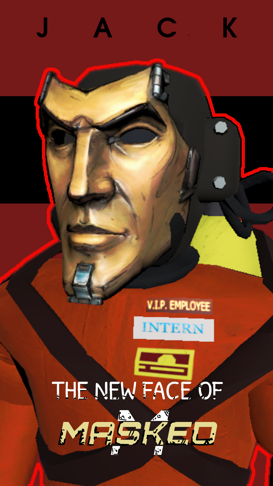

# HandsomeMasked

### Swaps the Masked's (And the Mask scrap's) audio and visuals to Borderland 2's Handsome Jack!

### Audio Replacement
Replaces the fixed 3 audio clips which are used by the masked entities and scrap with 38 new voicelines from Handsome Jack from Borderlands 2 and Borderlands: The Pre-Sequel: These voicelines are grouped and will play depending on the current AI state of the masked entity (or randomly for the mask scrap items). This includes:
- 6 voice clips (laughs) that can play while the Masked is roaming without a set target,
- 18 voice clips (Random sounds and funny phrases) that can play while the Masked is actively following an employee,
- 17 voice clips (funny phrases and insults) that can play while the Masked is in their chase state and is running towards an employee,
- 6 voice clips (taunts) that can play while the masked entity or scrap is converting an employee into a Masked.

To keep the mod clientside, the randomised time for a masked or mask scrap to play a voice clip is unchanged.

### Visual Replacement
The mask scrap and masks of the Masked are replaced with Handsome Jack's mask.

### Config Options
- Randomise All Voicelines - When enabled, aside from execution taunts voice clips, AI state is no longer used to determine the voice clip to be used, allowing any voice clip to be triggered in any AI state.
- Toggle Custom Voicelines - Custom voicelines for the mask scrap and masked entities can be separately toggled. (Requires a game restart).
- Toggle Custom Models - Custom models for the mask scrap and masked entities can be separately toggled. (Requires a game restart).
- Toggle Mask Audio on Ship - The audio produced by mask items while on the ship can be toggled, if the voicelines get too annoying and repetitive.

## See you soon, kiddo!

### Credits
Handsome Jack's Mask model taken from Gearbox Software's and 2K's legendary game Borderlands 2, this mod is not associated with either company, this is just a fan creation mod because Borderlands is awesome. Handsome Jack's voicelines were performed by Dameon Clarke, taken from Borderlands 2 and Borderlands: The Pre-Sequel (The latter produced by Gearbox and published by 2K).

Rubbishly-drawn poster inspired from a random one I saw in Borderlands 2, fonts used were Evolventa, Orbitron and Patrick Hand SC with the OpenFont License. It was gonna be the mod logo but it was too tall.